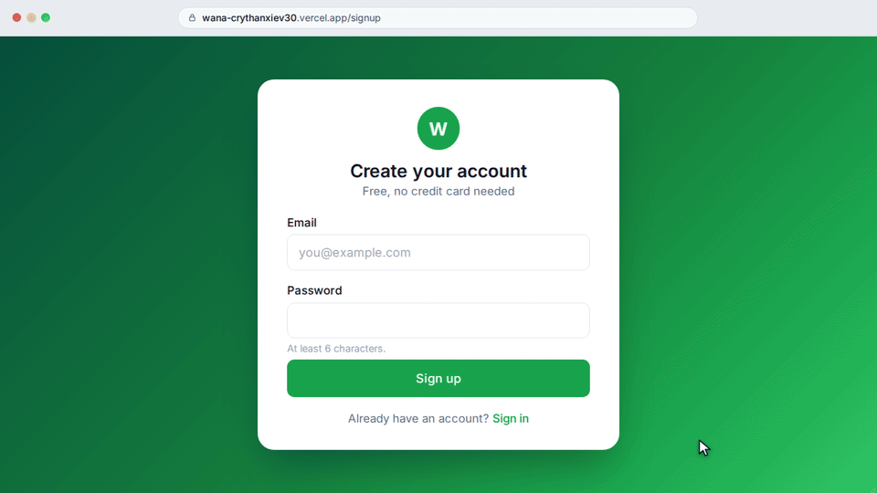

<div align="center">


# WANNA-CRY THANXIEE

**A branded, self-hardened WhatsApp bot — built on [Baileys](https://github.com/WhiskeySockets/Baileys) v7**

[](#)
[](#)
[](#)
[](#)

[Follow the channel](https://whatsapp.com/channel/0029VbE9KJvJkK73C7RNvP2z) · [View source](https://github.com/mrzeroexploitzw/wana-crythanxiev30) · [Report an issue](https://github.com/mrzeroexploitzw/wana-crythanxiev30/issues)

</div>

<br />

<div align="center">

<br />
<sub>Animated walkthrough of the pairing flow — sign up → pair a number → pairing code → session online. Rendered from the dashboard's own design (illustrative sample data).</sub>
</div>

<br />

## What every reply looks like

Every message the bot sends is wrapped in this card, with the bot image attached:

```
╭┈〔 INFO BOT 〕
┆𖤍╭────↯
┃𖤍│➣ OWNER: THANXIEE DEV
┃𖤍│➣ VERSION: 30.1.0
┃𖤍│➣ PREFIX: .
┃𖤍│➣ TODAY: Wednesday
┃𖤍│➣ DATE: 28/10/2026
┃𖤍│➣ UPTIME: 1h 29m 33s
┃𖤍│➣ RUNTIME: v22.23.4
┃𖤍│➣ MODE: 🌍 Public
┆𖤍╰────↯
╰┄┄┄┄┄┄┄┄┄┄┄┄┄〩
```

Generated live by [`src/branding.js`](src/branding.js) — owner, version, uptime and mode all pull from your `.env`, so this card is always accurate, never hardcoded copy.

<br />

## ✨ Features

| | |
|---|---|
| 🪪 **Branding** | Every message boxed in the card above, with the bot image, owner, version, prefix, date/uptime/runtime, and the [channel](https://whatsapp.com/channel/0029VbE9KJvJkK73C7RNvP2z) + [repo](https://github.com/mrzeroexploitzw/wana-crythanxiev30) links |
| 🕰️ **Antiban pacing** | Typing/recording presence, randomized human-like delays, a single global send queue, per-sender rate limiting |
| 🛡️ **Antisec hardening** | Structural validation on every inbound message (size/mention/contact caps, malformed-envelope rejection) with auto-kick after repeated violations — catches *new* attacks too, not just known ones |
| 🤖 **Gemini AI moderation** | Sexual content / abusive language auto-detected and removed, sender auto-kicked; protected by a 4-layer pipeline (prefilter → cache → queue → per-sender throttle) so one busy group can't burn the shared quota |
| 🌐 **Translator** | `.translate <language> <text>`, or reply to any message with `.translate <language>` |
| 👋 **Welcome / goodbye** | Randomized, branded messages on every join/leave |
| 📊 **Auto group stats** | A branded stats card posted every `STATS_INTERVAL_DAYS` days — messages, joins, leaves, top active members |
| 🛠️ **Group moderation** | kick · promote · demote · warn/unwarn/listwarn (auto-kick at 3) · antilink · antispam · tagall · hidetag · groupinfo |
| 🌍 **Web pairing dashboard** | Self-service sign-up, pairing code flow, session status, all matching the bot's own branding |

<details>
<summary><strong>🗺️ Not yet built</strong></summary>
<br />

The full 200+ command menu originally scoped (movies, downloaders, GFX, text-styling, games, stalk tools, URL shorteners, etc.) is planned but not yet implemented — this build is the hardened core plus the most recently requested features. Say the word and the next pass adds more command groups in priority order.

Commands needing third-party API keys were wired to free/no-key alternatives where one exists; a few (video/audio downloaders, lyrics, some "stalk" tools) rely on scraping public pages and may need occasional fixes if a target site changes layout — flagged in the handler comments for those once added.

</details>

<br />

## 🚀 Quick start (single bot, no dashboard)

```bash
npm install
cp .env.example .env    # fill in OWNERS, GEMINI_API_KEY, PAIRING_NUMBER
npm start
```

Enter the printed pairing code under **WhatsApp → Linked Devices → Link with phone number**, or scan the QR if `PAIRING_NUMBER` is left blank. The session saves to `auth_info/` — keep it private, it's already git-ignored.

<br />

## ☁️ Deploying the full platform (API + dashboard)

This repo has three deployable pieces:

| Piece | Where it runs | What it does |
|---|---|---|
| [`src/`](src/) | Anywhere (`npm start`) | The original single-number bot — self-hosted, no dashboard |
| [`server/`](server) | [Render](https://render.com) | Multi-tenant API + session manager — one Baileys socket per signed-up user, Postgres-backed auth state |
| [`dashboard/`](dashboard) | [Vercel](https://vercel.com) | The sign-up/pairing web UI — see [`dashboard/README.md`](dashboard/README.md) |

<details>
<summary><strong>Render setup</strong></summary>
<br />

1. Push this repo to GitHub.
2. On Render: **New → Blueprint**, point it at the repo — `render.yaml` provisions a free Postgres DB and the API service automatically.
3. Set `GEMINI_API_KEY` and `DASHBOARD_ORIGIN` (your Vercel URL) in the Render dashboard — both are `sync: false` in the blueprint so they're never committed.
4. Watch the logs on first boot to confirm it's up.

</details>

<details>
<summary><strong>Vercel setup</strong></summary>
<br />

1. **New Project** → import the same repo → set **Root Directory** to `dashboard`.
2. Set `NEXT_PUBLIC_API_BASE` to your Render API URL.
3. Deploy, then copy the resulting Vercel URL back into Render's `DASHBOARD_ORIGIN`.

</details>

<br />

## 📁 Project structure

<details>
<summary>Expand</summary>

```
docs/                      README assets (pairing-demo.gif)
src/                       the standalone single-number bot
  index.js                 connection, pairing/QR, reconnect logic
  config.js                all environment-driven settings
  db.js                    JSON-file storage (single-bot mode)
  branding.js              boxed-card renderer + image attachment
  assets/bot.png           default bot image
  lib/                     humanDelay · rateLimiter · antisec · gemini · scheduler
  data/                    welcomeTemplates · goodbyeTemplates · badwords
  handlers/                messageHandler · groupEvents · commandRouter
  commands/                core · moderation · ai · antisecCmd

server/                    multi-tenant API (Render)
  index.js                 Express app, routes
  db.js, dbAuthState.js    Postgres schema + Baileys auth-state adapter
  sessionManager.js        starts/stops/resumes per-user Baileys sockets
  auth.js                  signup/login, JWT middleware

dashboard/                 pairing web UI (Vercel)
  pages/                   login, signup, overview, pair, sessions, settings
  components/, lib/        Layout, StatCard, StatusBadge, API client
```

</details>

<br />

## 💬 Configuring from chat

```
.antilink on|off      .antispam on|off
.welcome on|off        .goodbye on|off
.antisecmenu            shows current protection thresholds
.allmenu                 full command list
.owner                    owner, repo and channel info
```

<br />

## 🔒 Security note

This build deliberately does **not** include any command that crashes, freezes, or otherwise attacks another device or WhatsApp account. The antisec system here is defensive only — it detects and auto-removes abusers; it does not provide attack tooling.

<br />

<div align="center">
<sub>WANNA-CRY THANXIEE · <a href="https://whatsapp.com/channel/0029VbE9KJvJkK73C7RNvP2z">Channel</a> · <a href="https://github.com/mrzeroexploitzw/wana-crythanxiev30">GitHub</a></sub>
</div>


## Free Render deployment notes

- `render.yaml` uses Render's **Free** web-service plan and exposes `/health` as the health-check endpoint.
- Free Render web services can sleep after 15 minutes without inbound traffic. When they wake, startup can take about a minute; a WhatsApp bot therefore cannot be guaranteed to stay connected 24/7 on the free plan.
- Free Render Postgres databases expire after 30 days. Back up/export your data or upgrade the database before expiry if you need persistent sessions beyond the trial period. The bot's Baileys credentials are stored in Postgres, not the ephemeral local filesystem.
- Do not rely on a self-ping loop to promise 24/7 availability. Use the built-in reconnect logic and the chat commands below for recovery. For always-on usage, move the API to an always-on paid service and use a database plan with durable retention.

### Chat recovery commands

In a **private chat** with a dashboard-managed bot session, send `.restart`, `.reconnect`, or `.reset`. These all perform a safe reconnect without deleting the saved WhatsApp pairing credentials. A 90-second cooldown prevents repeated reconnect requests. `.reset` does **not** unlink or erase the pairing; use the dashboard's Unlink action only when you intentionally want to remove a session.

### International pairing numbers

The dashboard accepts full international WhatsApp numbers from any country. Include the country calling code, for example `+263 771 234 567`. The server stores the number as digits only and validates it against the international 8–15 digit format before requesting a pairing code.
